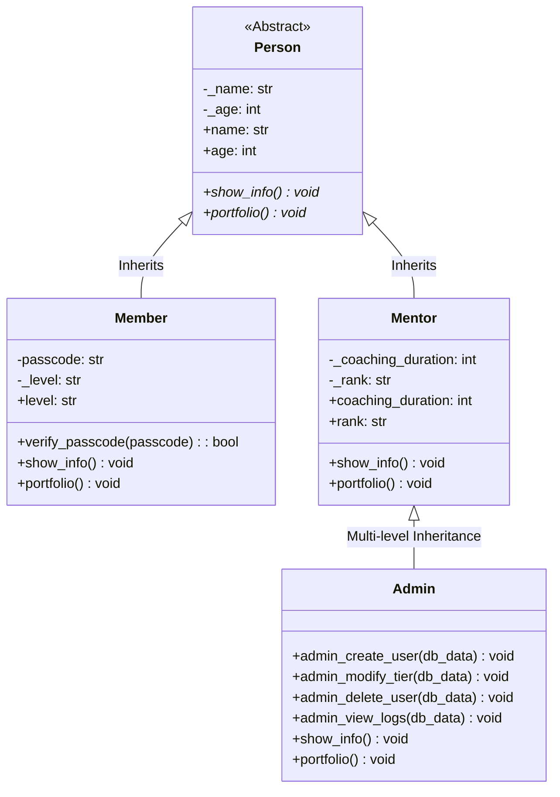
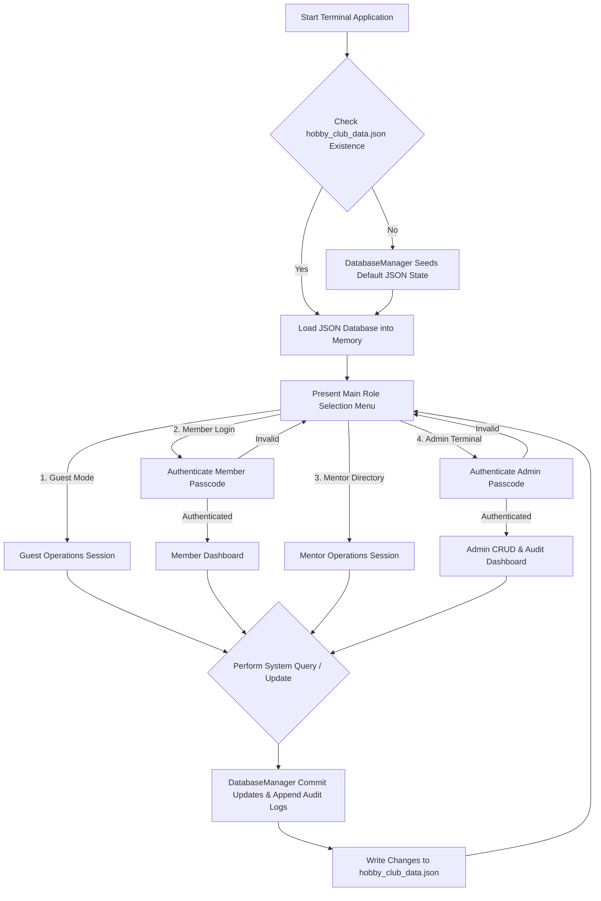

<div align="center">


# 🏆 Hobby Club Management System (HCMS)

> A production-ready, console-driven Python application demonstrating enterprise-level Object-Oriented Programming (OOP) paradigms, state-driven data persistence, strict data validation, and role-based access control (RBAC).

[](https://www.python.org/)
[](https://opensource.org/licenses/MIT)
[](https://github.com/rayaantasnim/Python-OOP-Final-Project)
[](https://github.com/rayaantasnim/Python-OOP-Final-Project/pulls)

---

</div>

## 📌 Executive Summary

The **Hobby Club Management System (HCMS)** is an extensible, terminal-based software system engineered in pure Python. Designed around rigorous software architecture standards, HCMS models real-world organizational hierarchies through abstract base classes, multi-level inheritance, encapsulated domain models, dynamic runtime polymorphism, and atomic JSON file persistence.

---

## ✨ Key Features

*   **🔒 Robust Object Encapsulation**: Private and protected attributes managed via Python `@property` decorators and custom validation logic to protect against invalid state mutations.
*   **💾 Atomic JSON Persistence**: Implements an automatic data-seeding engine and atomic read/write pipelines using a static `DatabaseManager` system.
*   **📋 Persistent Audit Logging**: Full administrative event tracking recorded seamlessly into a structured `audit_logs` persistence store.
*   **🔍 Case-Insensitive Regex Search**: Real-time registry search capabilities powered by Python's `re` module (`re.compile(..., re.IGNORECASE)`).
*   **⚙️ Multilevel RBAC Framework**: Strict privilege separation across four distinct user personas: **Guests**, **Members**, **Mentors**, and **Admins**.
*   **🚨 Robust Exception & Guard Clause Pipeline**: Zero-crash terminal workflow utilizing standard library guards, input validation, and clean error recovery.

---

## 🏛 Architecture & Design Patterns

HCMS explicitly leverages the four fundamental pillars of Object-Oriented Programming:

1.  **Abstraction**: The base `Person` class derives from Python's `abc.ABC` module. It defines structural interfaces via `@abstractmethod` primitives (`show_info()` and `portfolio()`) that mandate concrete implementation contracts down the object hierarchy.
2.  **Inheritance**: Uses single-level (`Person` $\rightarrow$ `Member`, `Person` $\rightarrow$ `Mentor`) and multi-level (`Person` $\rightarrow$ `Mentor` $\rightarrow$ `Admin`) class inheritance hierarchies to foster code reuse.
3.  **Encapsulation**: Private instance attributes (such as `__passcode`) prevent direct external mutation. Setter validation enforces strict invariants across levels (`{"Beginner", "Pro", "Expert", "Trained"}`) and authentication credentials.
4.  **Polymorphism**: Unified call interfaces enable runtime duck-typing and uniform processing across heterogeneous collections of `Person` subclasses.

### Class Hierarchy Diagram



### System Runtime Flowchart



---

## 🔑 Access Control Matrix (RBAC)

| System Capabilities | Guest 👤 | Member 🚴 | Mentor 🎓 | Admin ⚡ |
| :--- | :---: | :---: | :---: | :---: |
| **View Club Info & Announcements** | ✅ | ✅ | ✅ | ✅ |
| **Perform Case-Insensitive Search** | ✅ | ✅ | ✅ | ✅ |
| **Access Personal Portfolio Dashboard** | ❌ | ✅ | ✅ | ✅ |
| **Manage Member Passcode & Tier** | ❌ | ✅ | ❌ | ✅ |
| **View Coaching Duration & Mentor Registers**| ❌ | ❌ | ✅ | ✅ |
| **Create New User Accounts (CRUD)** | ❌ | ❌ | ❌ | ✅ |
| **Modify User Tiers & Passcodes** | ❌ | ❌ | ❌ | ✅ |
| **Delete Users from Persistent Store** | ❌ | ❌ | ❌ | ✅ |
| **Inspect System Audit Logs** | ❌ | ❌ | ❌ | ✅ |

---

## 💻 Interactive Code Deep Dives

<details>
<summary><b>🔍 View Encapsulation & Validation Logic Example (`Person` & `Member`)</b></summary>

```python
from abc import ABC, abstractmethod

class Person(ABC):
    def __init__(self, name: str, age: int):
        self.name = name  # Invokes property setter logic
        self.age = age

    @property
    def name(self) -> str:
        return self._name

    @name.setter
    def name(self, value: str):
        if not isinstance(value, str) or not value.strip():
            raise ValueError("Name must be a non-empty string.")
        self._name = value.strip()

    @property
    def age(self) -> int:
        return self._age

    @age.setter
    def age(self, value: int):
        if not isinstance(value, int) or value <= 0:
            raise ValueError("Age must be a positive integer.")
        self._age = value

    @abstractmethod
    def show_info(self):
        pass


class Member(Person):
    VALID_LEVELS = {"Beginner", "Pro", "Expert", "Trained"}

    def __init__(self, name: str, age: int, passcode: str, level: str = "Beginner"):
        super().__init__(name, age)
        self.passcode = passcode
        self.level = level

    @property
    def passcode(self) -> str:
        return self.__passcode

    @passcode.setter
    def passcode(self, value: str):
        if len(str(value)) < 4:
            raise ValueError("Passcode must be at least 4 characters long.")
        self.__passcode = str(value)
```

</details>

<details>
<summary><b>💾 View Persistence Layer Details (`DatabaseManager`)</b></summary>

```python
import json
import os
from datetime import datetime

class DatabaseManager:
    DB_FILE = "hobby_club_data.json"

    @staticmethod
    def initialize_db():
        """Seeds default database schema if JSON file does not exist."""
        if not os.path.exists(DatabaseManager.DB_FILE):
            default_schema = {
                "members": [],
                "mentors": [],
                "admins": [
                    {
                        "name": "Grace Hopper",
                        "age": 85,
                        "passcode": "admin123",
                        "coaching_duration": 50,
                        "rank": "Senior"
                    }
                ],
                "audit_logs": []
            }
            DatabaseManager.write_db(default_schema)
            DatabaseManager.log_event("Database initialized with default admin.")

    @staticmethod
    def read_db() -> dict:
        DatabaseManager.initialize_db()
        with open(DatabaseManager.DB_FILE, "r") as file:
            return json.load(file)

    @staticmethod
    def write_db(data: dict):
        with open(DatabaseManager.DB_FILE, "w") as file:
            json.dump(data, file, indent=4)

    @staticmethod
    def log_event(action: str):
        data = DatabaseManager.read_db()
        timestamp = datetime.now().strftime("%Y-%m-%d %H:%M:%S")
        data["audit_logs"].append(f"[{timestamp}] {action}")
        with open(DatabaseManager.DB_FILE, "w") as file:
            json.dump(data, file, indent=4)
```

</details>

---

## 🚀 Getting Started

### Prerequisites

Ensure you have Python 3.9 or higher installed on your system. You can verify your version by running:

```bash
python --version
```

### Installation & Execution

1. **Clone the Repository:**
   ```bash
   git clone https://github.com/rayaantasnim/Python-OOP-Final-Project.git
   cd Python-OOP-Final-Project
   ```

2. **Execute the Application:**
   ```bash
   python main.py
   ```

> [!NOTE]
> The system automatically detects if `hobby_club_data.json` is missing and generates the default database schema upon startup.

### Default Administrator Credentials

To access administrative functionalities (User CRUD, System Audit Logs, Tier Modifications):

* **Admin Name:** `Grace Hopper`
* **Passcode:** `admin123`

> [!IMPORTANT]
> Keep administrative credentials secure! Passcode changes can be performed directly through the Admin Terminal under option `Modify Credentials`.

---

## 🗄 Database Schema Structure

Data is stored locally inside `hobby_club_data.json`. The standard schema definition is formatted as follows:

```json
{
    "members": [
        {
            "name": "Alice Smith",
            "age": 24,
            "passcode": "member123",
            "level": "Beginner"
        }
    ],
    "mentors": [
        {
            "name": "Bob Martin",
            "age": 42,
            "coaching_duration": 12,
            "rank": "Senior"
        }
    ],
    "admins": [
        {
            "name": "Grace Hopper",
            "age": 85,
            "passcode": "admin123",
            "coaching_duration": 50,
            "rank": "Senior"
        }
    ],
    "audit_logs": [
        "[2026-10-21 14:00:00] Database initialized with default admin."
    ]
}
```

---

## 🤝 Contributing

Contributions are welcomed! Follow these steps to contribute:

1. Fork the Project Repository.
2. Create your Feature Branch (`git checkout -b feature/AmazingFeature`).
3. Commit your Changes (`git commit -m 'Add some AmazingFeature'`).
4. Push to the Branch (`git push origin feature/AmazingFeature`).
5. Open a Pull Request.

---

## 📄 License

Distributed under the MIT License. See `LICENSE` for more information.

---

<div align="center">
  <sub>Built with ❤️ by <a href="https://github.com/rayaantasnim">Rayaan Tasnim</a></sub>
</div>
